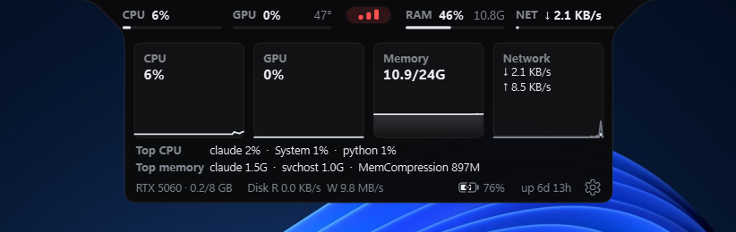
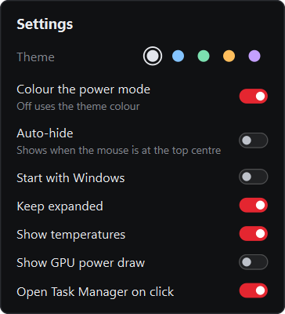

<div align="center">

# LegionNotch

A system monitor that lives in a notch at the top of your screen.


</div>

## Install

```powershell
irm https://raw.githubusercontent.com/apinanaivot/LegionNotch/main/install.ps1 | iex
```

Windows 10 or 11. No admin rights or Python needed. Run it again to update.

## Features



- CPU, GPU, RAM and network at a glance
- Hover for live graphs and the busiest apps
- Click a stat to open Task Manager
- Click the middle pill to switch power mode
- Pauses itself under fullscreen apps, on the lock screen and with the display off



## Settings

Open them with the gear in the expanded view.

- Five colour themes
- Auto-hide until the mouse is at the top of the screen
- Start with Windows
- Keep expanded
- Temperatures and GPU power draw

<br clear="right">

## Notes

- GPU stats need an NVIDIA card.
- CPU temperature needs [LibreHardwareMonitor](https://github.com/LibreHardwareMonitor/LibreHardwareMonitor) running with its web server on.

## Uninstall

From settings, or:

```powershell
irm https://raw.githubusercontent.com/apinanaivot/LegionNotch/main/uninstall.ps1 | iex
```

<details>
<summary>Run from source</summary>

```
pip install -r requirements.txt
pythonw notchbar.pyw
```

Build the release zip with `pip install pyinstaller` and `.\build.ps1`.

</details>
